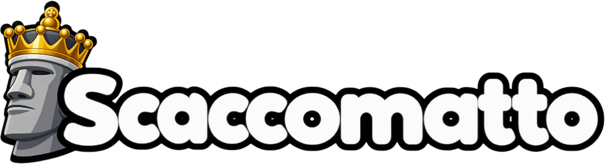
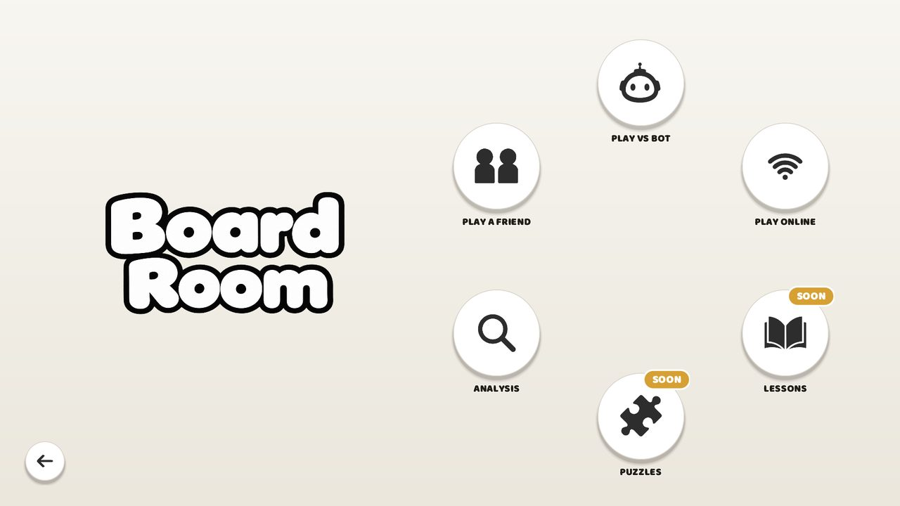

<p align="center"></p>

<p align="center"><b>Chess, with personality.</b><br>
A free chess game for Windows and Linux by Alekhine Studios Private Limited.</p>

<p align="center"><a href="../../releases/latest"><b>Download the latest version</b></a></p>

<p align="center"></p>

## What's in it

- **Eight variants.** Classic, Chess960, King of the Hill, Three-check, Atomic, Fog of War and Duck Chess, with Spell Chess coming later.
- **Bots with a story.** Each one plays its own way, from Gary, who grabs anything you leave hanging, up to Margot.
- **Analysis and Game Review.** Load a game, step through it, and see which moves were good and which ones lost it.
- **Play anyone, anywhere.** Send a friend a six-letter code, or let Join Game find you an opponent online.
- **Friends.** Add friends, see who's online and challenge them to a game.
- **Optional accounts.** Sign in with email or Google for a rating, a leaderboard spot, and achievements that follow you between computers.
- **Achievements**, three piece sets, board themes, and light and dark mode.

The engine, **Argus**, was written from scratch for Scaccomatto. It plays every bot and runs the analysis.

## Installing

**Windows:** run `Scaccomatto-Setup-<version>.exe`. If Windows says "Windows protected your PC", click *More info*, then *Run anyway* (the installer isn't signed with a paid certificate yet).

**Linux (Debian, Ubuntu, Mint):**

```bash
sudo apt install ./scaccomatto_<version>_amd64.deb
```

Both installers include their own Java, so there's nothing else to install.

## Building it yourself

You need JDK 17 or newer and Maven.

```bash
mvn package                 # builds target/scaccomatto-<version>.jar
java -jar target/scaccomatto-<version>.jar
bash build-installer.sh     # Linux .deb, in installers/
```

The game reads its Firebase settings from `src/main/assets/firebase.properties`, which stays on your computer (it's in `.gitignore`). The Windows build on GitHub gets the same file from a repository secret; set it once (and again whenever the file changes) with `gh secret set FIREBASE_PROPERTIES < src/main/assets/firebase.properties`.

The Windows installer is built by GitHub Actions (`.github/workflows/windows-installer.yml`): run it from the Actions tab, or push a tag like `v1.0.1` to build it and attach it to a release. Before each release, raise the version in `pom.xml` and `AppVersion.java`, otherwise Windows treats the new installer as the same version.

## Project layout

| Folder | What's in it |
|---|---|
| `src/main/java` | The game (Swing). `Main.java` starts it. |
| `src/main/java/argus` | Argus, the chess engine |
| `src/main/assets` | Pictures, sounds, music, fonts, the opening book |
| `database.rules.json` | The Firebase database rules: paste into Realtime Database > Rules after changing them |
| `docs` | The download website (GitHub Pages) |
| `packaging` | Installer icon and the Windows build workflow |

## Privacy and credits

Without an account, nothing about you is kept anywhere but your own computer. Accounts and internet games run on Google Firebase; [docs/privacy.html](docs/privacy.html) lists exactly what's stored. Music, sounds, piece sets and fonts by other people are listed in [docs/credits.html](docs/credits.html) and in the app under Settings → About.

## Contact

alekhinestudios@gmail.com

© 2026 Alekhine Studios Private Limited
