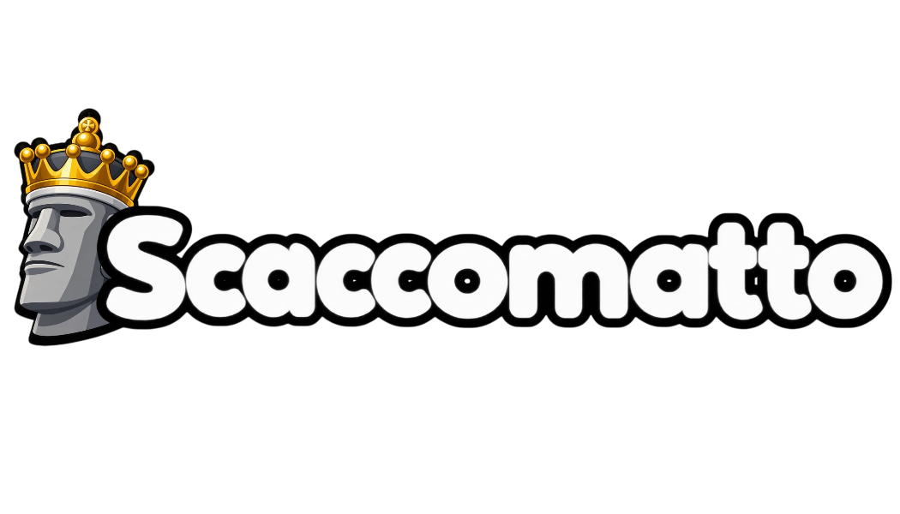

<p align="center"></p>

<p align="center"><b>Chess, with personality.</b><br>
Made by Alekhine Studios, for Windows and Linux.</p>

<p align="center"><a href="https://curious3dofficial.github.io/scaccomatto-full-site/"><b>Get it here</b></a></p>

## What it is

A chess game I've been building for a while. Normal chess, plus the weird stuff:

- **Seven variants:** Classic, Chess960, King of the Hill, Three-check, Atomic, Fog of War and Duck Chess. Spell Chess is on the way.
- **Bots with actual personalities.** Gary will take anything you hang. Margot won't let you get away with much.
- **Online play.** Send a friend a six-letter code, or hit Join Game and get matched with someone.
- **Accounts if you want them.** Rating, leaderboard, friends, achievements that follow you around. You can also just play as a guest.
- **Analysis and Game Review** to find out exactly where it went wrong.
- Ten piece sets (one of them is cats), board themes, light and dark mode.

The engine, **Argus**, is written from scratch. It plays all the bots and does the analysis.

## Installing

**Windows:** run `Scaccomatto-Setup-<version>.exe`. Windows will probably warn you because the installer isn't signed. Click *More info*, then *Run anyway*.

**Linux (Debian / Ubuntu / Mint):**

```bash
sudo apt install ./scaccomatto_<version>_amd64.deb
```

Java comes bundled, so that's it.

## Building it

JDK 17+ and Maven.

```bash
mvn package                 # target/scaccomatto-<version>.jar
java -jar target/scaccomatto-<version>.jar
bash build-installer.sh     # Linux .deb, ends up in installers/
```

Don't run the build with sudo, or Maven can't clean up after itself next time.

Firebase settings live in `src/main/assets/firebase.properties`. It's gitignored on purpose. The GitHub build gets it from the `FIREBASE_PROPERTIES` secret, so if the file changes, update the secret too:

```bash
gh secret set FIREBASE_PROPERTIES < src/main/assets/firebase.properties
```

## Releasing

1. Bump the version in `pom.xml` and `AppVersion.java`.
2. Push, then run `gh workflow run release-full.yml --repo Curious3dofficial/scaccomatto-full-code --ref master`. That builds the Windows and Linux installers on GitHub and puts them on scaccomatto-full-site.
3. Once they're up, set `meta/latest` (and `meta/downloadUrl`) in the Firebase database so older copies show the "new version" note.

## Engine updates

The full game updates Argus by itself. After changing the engine:

```bash
bash publish-argus.sh
```

It builds Argus, makes sure it can still find a move, signs it and uploads it to the `engine` release on scaccomatto-free-site. Games pick it up in the background and switch over next launch. If the new one breaks, they fall back to the Argus they shipped with. (Scaccomatto Free never updates its engine.)

First time only: `java tools/ArgusPublish.java keygen` makes the signing key in `~/.scaccomatto-signing/`. Back it up and never commit it. After each publish, commit `src/main/assets/engine/argus.version`.

## What's where

| Folder | |
|---|---|
| `src/main/java` | The game. `Main.java` starts it. |
| `src/main/java/argus` | Argus, the engine |
| `src/main/assets` | Pictures, sounds, music, fonts, piece sets, the opening book |
| `database.rules.json` | Firebase database rules. Paste into Realtime Database > Rules after changing them. |
| `packaging/windows` | The Windows installer icon |
| `.github/workflows` | The GitHub builds |
| `tools`, `publish-argus.sh` | Engine publishing |

## Privacy and credits

No account means nothing about you leaves your computer. Accounts and online games run on Google Firebase. Exactly what gets stored is in the game under Settings > About > Privacy policy. Music, sounds, piece sets and fonts by other people are credited there too.

## Contact

alekhinestudios@gmail.com

© 2026 Alekhine Studios
